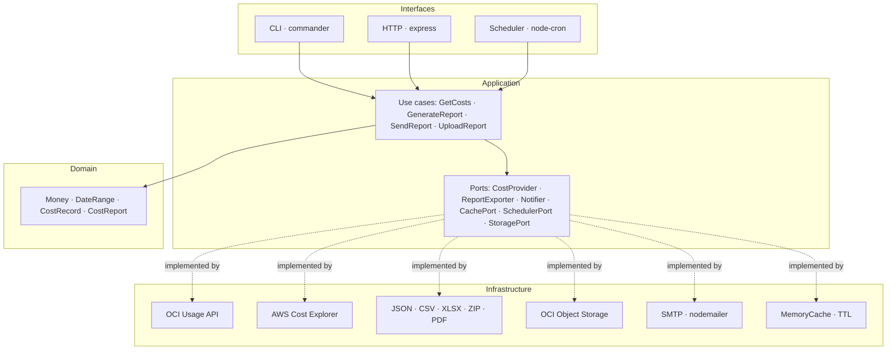

# cloudcost

[](https://github.com/josuejcalazans/cloudcost/actions/workflows/ci.yml)
[](./LICENSE)
[](https://nodejs.org)
[](#testing)

**Multi-cloud cost intelligence for OCI and AWS** — one CLI, one HTTP API, five
export formats (JSON / CSV / XLSX / ZIP / PDF) and scheduled email reports,
built as a reusable library with a test-driven, hexagonal architecture.

> Runs directly on **Node ≥ 24** — no build step. The whole codebase is
> erasable-only TypeScript executed natively by Node's type stripping.

```bash
node src/cli.ts costs --provider oci --from 2026-10-01 --to 2026-11-01 \
  --group-by service --format pdf --title "October report" \
  --compare-from 2026-09-01 --compare-to 2026-10-01 --upload
```

## Features

- **Multi-cloud**: Oracle Cloud (Usage API — same data as the console's Cost
  Analysis) and AWS (Cost Explorer `GetCostAndUsage`), behind one port.
- **Five formats**: `json`, `csv`, `xlsx` (Summary + Records sheets), `zip`
  bundling all three artifacts and `pdf` — a styled report with KPI boxes, a
  daily bar chart, grouped tables and page footers.
- **Period comparison**: `--compare-from` / `--compare-to` fetches a second
  window and renders totals, delta and percentage change side by side
  (embedded in `pdf` and `json` output).
- **Object Storage upload**: `--upload` publishes the generated report to
  OCI Object Storage (S3-compatible endpoint) under a configurable
  `--prefix` and prints the object URL.
- **CLI** for ad-hoc reports, **HTTP API** for dashboards, **cron scheduler**
  for weekly email digests — all sharing the same use cases.
- **Email reports** with the file attached and top-5 cost groups in the body.
- **Layered caching** (TTL, O(1) lookups) so dashboards don't re-hit the cloud
  APIs on every refresh.
- **API-key auth** for the HTTP routes (`x-api-key`), optional.
- **Resilient parsing**: malformed provider rows are dropped instead of
  failing an entire report; scheduled task failures never kill the process.

## Quick start

```bash
git clone https://github.com/josuejcalazans/cloudcost.git
cd cloudcost
npm install
cp .env.example .env   # fill in credentials

# one-off report
npm run cli -- costs --provider oci --from 2026-10-01 --to 2026-11-01 --out report.csv

# HTTP API on :3000
npm run serve

# weekly Monday 07:00 email digests
npm run cli -- schedule --provider oci --cron "0 7 * * 1"
```

Install globally with `npm link` to get a `cloudcost` binary anywhere.

## CLI

| Command | Purpose |
|---|---|
| `cloudcost costs --provider oci --from D --to D [--group-by service\|region\|day\|provider] [--format json\|csv\|xlsx\|zip\|pdf] [--out file] [--title text] [--compare-from D --compare-to D] [--upload] [--prefix p]` | Fetch costs and export a report (stdout when `--out` is omitted; `--upload` stores it in Object Storage and prints the URL) |
| `cloudcost report email --provider oci --from D --to D [--recipient a@b.c ...] [--format csv]` | Generate and email a report |
| `cloudcost schedule [--cron "0 7 * * 1"] [--timezone America/Sao_Paulo] [--days 30]` | Run recurring email reports |
| `cloudcost serve [--port 3000]` | Start the HTTP API |

Dates are `YYYY-MM-DD`, start inclusive / end exclusive (exactly how usage
APIs bill).

## HTTP API

| Method | Path | Description |
|---|---|---|
| `GET` | `/health` | Liveness probe (never requires the API key) |
| `GET` | `/api/v1/costs?provider=oci&from=2026-10-01&to=2026-11-01&group_by=service&format=csv` | Cost report in the requested format |
| `POST` | `/api/v1/reports/email` | Body `{ "provider", "from", "to", "group_by?", "format?", "recipients?" }` — sends the report by email |

Responses carry `Content-Type` and `Content-Disposition` headers, so the
browser downloads the file directly. Errors are JSON: `{ "error": "..." }`
with `400` (bad query), `401` (bad/missing API key), `404` (provider not
configured) or `500`.

```bash
curl "http://localhost:3000/api/v1/costs?provider=oci&from=2026-10-01&to=2026-11-01&format=zip" \
  -H "x-api-key: $API_KEY" -o costs.zip
```

## Library usage

```ts
import { createCloudCost, DateRange } from 'cloudcost';

const { generateReport } = createCloudCost();

const { report, buffer } = await generateReport.execute({
  provider: 'oci',
  range: DateRange.of('2026-10-01', '2026-11-01'),
  groupBy: 'service',
  format: 'xlsx',
});

console.log(report.total, report.groups[0]);
```

Every dependency is injectable (`providers`, `cache`, `exporters`,
`notifier`, `storage`), so tests and custom integrations plug in without
touching the core.

## Architecture

Hexagonal (ports & adapters) inside a DDD layering — dependencies point
inward, the domain has zero I/O:



| Layer | Depends on | Contains |
|---|---|---|
| `domain/` | nothing | value objects, entities, aggregation — pure functions and invariants |
| `application/` | `domain/` | use cases + port interfaces |
| `infrastructure/` | `application/` | adapters: cloud SDKs, exporters, SMTP, cache, cron |
| `interfaces/` | `application/` | Express app, commander CLI, composition helpers |

See [ARCHITECTURE.md](./ARCHITECTURE.md) for the full design notes, the
error taxonomy and the extension guide (adding a new cloud provider).

## Complexity at a glance

| Operation | Time | Space | Notes |
|---|---|---|---|
| Provider fetch + mapping | `O(n)` | `O(n)` | `n` usage rows, single API round trip |
| Cache hit (repeat query) | `O(1)` | — | hash lookup keyed by `provider + range` |
| Report aggregation | `O(n + k log k)` | `O(k)` | `k` distinct group keys; hash-map fold + sort |
| JSON / CSV serialization | `O(n)` | `O(n)` | one pass over records |
| XLSX rendering | `O(n)` | `O(n)` | sequential row writes |
| ZIP bundle | `O(n)` | `O(n)` | three serializations run in parallel |
| Route auth | `O(1)` | — | single header comparison |

`n` is the number of usage rows in the requested window (typically hundreds
to a few thousand for a monthly report).

## Configuration

Environment variables (see [.env.example](./.env.example)):

| Variable | Default | Purpose |
|---|---|---|
| `OCI_TENANCY_ID` / `OCI_USER_ID` / `OCI_FINGERPRINT` / `OCI_PRIVATE_KEY` (or `OCI_PRIVATE_KEY_PATH`) / `OCI_REGION` | — / `us-ashburn-1` | OCI env auth, same variables as springbot/www (aliases: `OCI_TENANCY_OCID`, `OCI_USER_OCID`) |
| `OCI_CONFIG_FILE` / `OCI_PROFILE` | `~/.oci/config` / `DEFAULT` | config-file fallback, used only when the env variables above are empty |
| `OCI_NAMESPACE` / `OCI_BUCKET` / `OCI_ACCESS_KEY_ID` / `OCI_SECRET_ACCESS_KEY` | — | Object Storage uploads (`--upload`); `OCI_REGION` defaults to `us-ashburn-1` |
| `AWS_REGION` / `AWS_PROFILE` | `us-east-1` / `default` | AWS Cost Explorer |
| `SMTP_HOST` / `SMTP_PORT` / `SMTP_SECURE` / `SMTP_USER` / `SMTP_PASS` | — | outbound mail |
| `MAIL_FROM` / `MAIL_TO` | `cloudcost@example.com` / — | default sender and recipients (comma-separated list) |
| `REPORT_CRON` / `REPORT_TIMEZONE` | `0 7 * * 1` / `America/Sao_Paulo` | scheduler defaults |
| `PORT` / `API_KEY` | `3000` / — | HTTP server; when `API_KEY` is set, `/api/*` requires `x-api-key` |
| `CACHE_TTL_SECONDS` | `300` | report cache TTL |

## Testing

144 tests across 22 files — domain invariants, use cases with fake ports,
each adapter against fake transports/clients, and the HTTP API exercised
over a real socket:

```bash
npm test          # vitest
npm run lint      # biome check
```

The suite is test-first: failing tests are written before each unit (git
history keeps that order).

## Why there is no build step

Node ≥ 24 strips TypeScript types natively. The source is deliberately
restricted to **erasable syntax** (no enums, no namespaces, no constructor
parameter properties), so `node src/cli.ts` just works and `npm publish`
ships `src/` as-is. Biome handles linting and formatting; Vitest runs the
tests.

## License

[MIT](./LICENSE)
